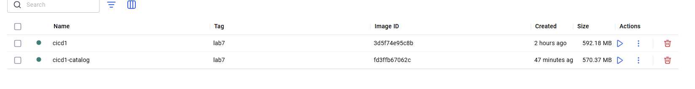

# CICD-1 Purchase Order Service

## Overview

The Purchase Order Service is a Spring Boot microservice responsible for managing customer orders.

This service provides REST endpoints for creating and retrieving purchase orders. For Lab 1, all order data is stored in an in-memory Java List and is lost when the application is restarted.

## Technology Stack

- Java 21
- Spring Boot
- Maven
- Spring Web
- Spring Validation
- Lombok
- Springdoc OpenAPI (Swagger UI)

## Service Configuration
| Property | Value |
|-----------|---------|
| Service Name | purchaseOrder-service |
| Port | 8082 |

1. The Dockerfile copies the built JAR file from target/ into the image.
mvn package must run first so that the JAR exists;
otherwise docker build will fail because there is no artifact to copy.
2. A Docker image is a read-only blueprint that contains the application, dependencies, and configuration.
A container is a running instance of that image with its own processes, memory, and writable layer.
3. 8082:8082 maps host port 8082 to container port 8082 (host:container). EXPOSE 8082 only documents that the container uses port 8082;
it does not publish the port. The application is accessible from Windows only when the port is mapped (for example with -p 8082:8082 or in Docker Compose).
4. Inside a container, localhost refers to that container itself, not the host machine or another container. 
The Order container will try to connect to port 8081 inside itself, where the Catalog service is not running. Containers should communicate using service names (for example catalog:8081) on the Docker network.
5. The product survived because the database data was stored in a persistent Docker volume or another external storage location. When the containers were recreated, the data remained.
With an in-memory H2 database, all data would be lost when the container stops, so after docker compose down and up -d the database would start empty.

